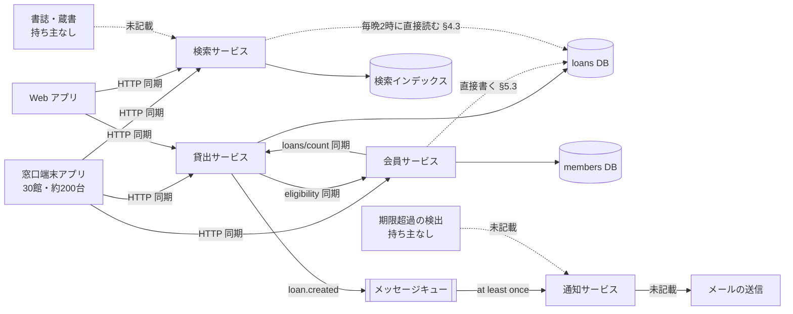
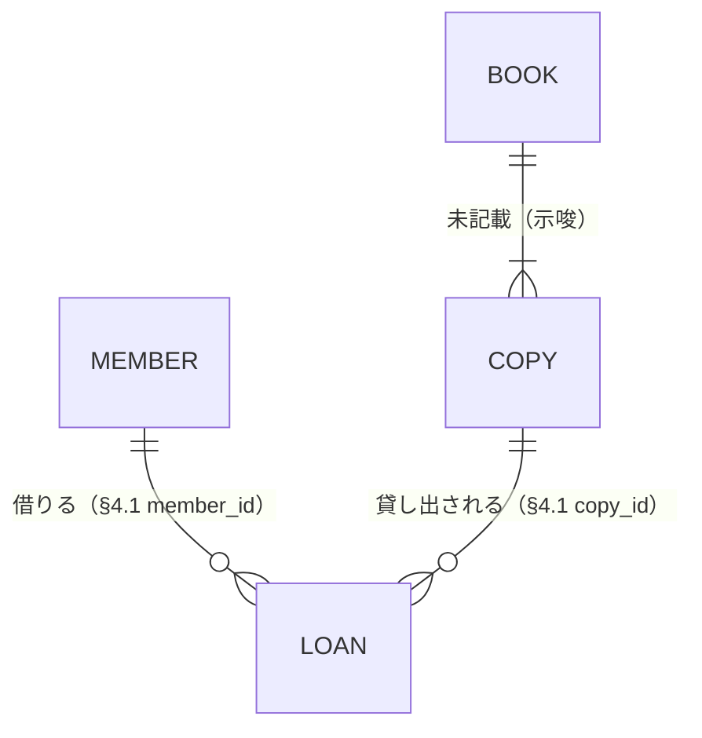
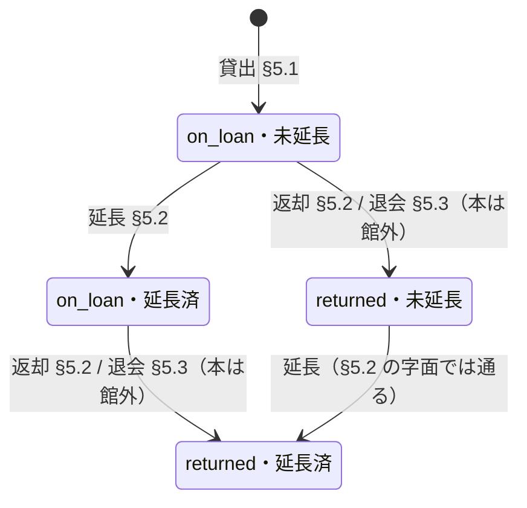
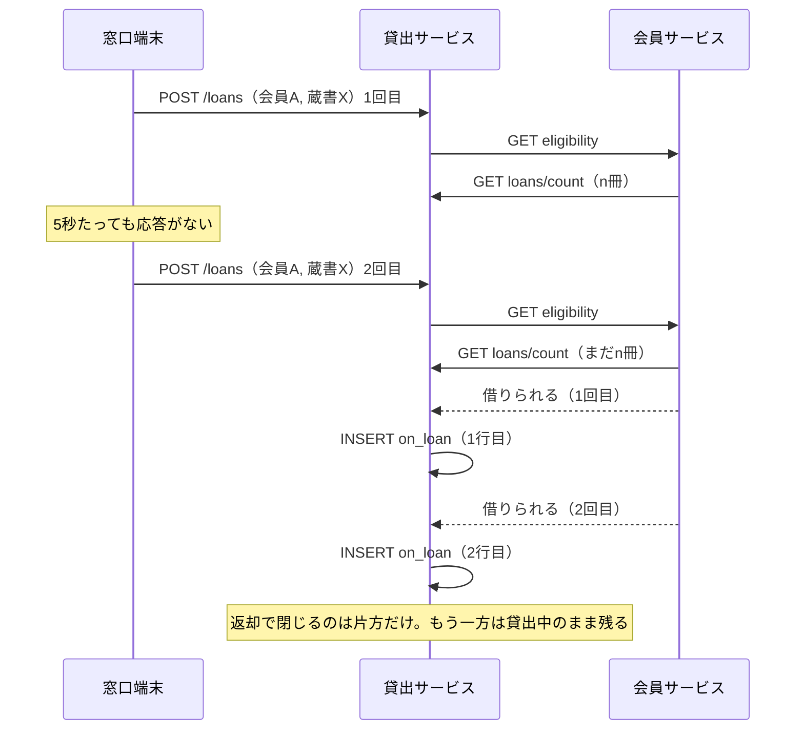

# 「市立図書館 貸出システム サービス分割 設計書 v0.4」レビュー

設計書を、構造、データの持ち主、ドメインの規則、状態遷移、API の契約、権限、障害、並行性、移行のモデルに書き起こして確かめました。

特に影響が大きいのは次の三つです。

- 移行の1週間、旧システムと新サービスの両方が書き込みを受けてしまうこと。
- API の認証と認可が書かれていないこと。
- 他のサービスの DB を直接読み書きする設計になっていること。

また、§2 で引き継ぐと書いた業務のうち、期限超過の通知と「メールか電話」の連絡先は、設計のどこにも引き継がれていません。

所見は影響の大きい順に並べています。各所見の「モデル」は、末尾の付録の該当箇所を指します。

## 所見

### 1. 移行の1週間、旧システムと新サービスの両方が書き込みを受けるのでは？

- **種類**: 矛盾
- **箇所**: 次の二つの記述がぶつかります。
  - §7 の注記「旧システムと新しいサービスに、同時に書き込むことはない」
  - §7 手順3「1週間かけて館ごとに更新する。Web アプリは、最初の館を更新する日に新しい版に切り替える」
- **モデル**（付録 I）: 手順3の行で「書き込み先」が一つに決まりません。
  - 未更新の館の端末は旧に書きます。
  - 更新済みの館の端末と Web は新に書きます。
  - 二つの系のあいだでデータを同期する手順はありません。
- **いつ問題になるか**: 手順3の初日から最終日までの約1週間、毎日起こりえます。互換性の表（付録 I）では、次の組み合わせが壊れます。
  - **新で借りた本を未更新の館で返す**（Web か更新済みの館で借りた場合）: 旧にはその貸出がありません。§2 の「どの館の窓口でも返せる」が成り立ちません。
  - **コピー後に未更新の館で借りた本を、更新済みの館で返す**: 新にはその貸出がありません。
  - **コピー前からの貸出を、更新済みの館で返す**: 新では `returned` になりますが、旧では貸出中のまま残ります。旧での冊数にも数えられ続けます。
  - **コピー前からの貸出を Web（新）で延長する**: 旧では元の期限のままです。旧が期限超過を知らせ続けるとすると、延長した会員に期限超過の知らせが届きます（旧が知らせ続けるというのは仮定です）。
  - **上限の判定**: それぞれの系は自分の冊数しか見ないので、旧で10冊、新で10冊、合わせて20冊借りられます。
  - **未更新の館で登録した会員**: 新にいないので、Web（新）で借りることも延長することもできません。
- **注記の別の読み方**: 注記が「一つの操作で旧と新の両方に書くことはない（二重に書き込まない）」という意味なら、矛盾ではなくなります。それでも、1週間のあいだ貸出と会員のデータが二つの系に分かれ、どちらの系も全体を持たないという抜けは残ります。
- **問い**: 1週間のあいだ、貸出と会員の正はどちらの系ですか。もう一方の系で貸した本の返却を受け付けますか。受け付けるなら、それを相手の系にどう反映しますか（双方向に同期する、全館と Web を一度に切り替える、など）。

### 2. コピーのあとで旧システムに入った書き込みは、いつ新しいデータベースに移りますか？

- **種類**: 抜け
- **箇所**:
  - §7 手順2「土曜の夜に行い、数時間かかる見込みである。その間も旧システムは動かしておく」
  - §7 手順4
  - §7 の注記「その端末を旧の版に戻す」
- **モデル**（付録 I の手順表）: 「書き込み先」と「戻し方」の列に空欄が残ります。
  - **手順2**: 次の書き込みを新に運ぶ手順がありません。
    - コピーの最中に旧に入った貸出・返却・会員登録
    - コピーのあと、各館が切り替わるまでに旧に入った貸出・返却・会員登録

    手順2から手順3までに何日あくのかも書かれていません。
  - **手順4**: 旧を止めるとき、旧にしかない1週間分の書き込みをどうするかが書かれていません。どの時点から旧に戻れなくなるのかも書かれていません。
  - **切り戻し**: 端末を旧版に戻しても、その端末が新で行った貸出・返却は旧にありません。Web を戻すのか、戻すならどうするのかも書かれていません。
- **いつ問題になるか**:
  - 手順2の最中に旧で返却された本は、新では貸出中のまま残ります。逆に、コピー後に旧で貸した本は新にありません。
  - 旧を止めた時点で旧にしかなかった貸出は消えます。その本が戻ってこなくても、誰も気づけません。
- **問い**: 差分の移行を行いますか。行うなら、いつ、何を移しますか。端末を旧版に戻すとき、新で受けた書き込みはどう旧に戻しますか。どの時点からは旧に戻れないのかを決めてください。

### 3. 各サービスは、呼び出し元が誰で、その操作をしてよいかをどう確かめますか？

- **種類**: 抜け
- **箇所**: §3「窓口端末アプリと Web アプリは、各サービスの API を直接呼ぶ」、§6 の「呼ぶもの」列
- **モデル**（付録 F）:
  - §6 の「呼ぶもの」は意図を示していますが、呼び出し元を確かめる仕組みの行は、8つの API すべてで空欄です。
  - Web から呼ぶとき、会員本人のデータだけに限るかどうかも空欄です。
- **いつ問題になるか**: Web アプリが会員のブラウザで動き、インターネットから各サービスに届くと仮定します（設計書には書かれていません）。その場合、次のことが起こりえます。
  - `DELETE /members/{id}` は、意図では窓口端末だけが呼ぶものですが、誰でも呼べてしまいます。§5.3 により、その会員の貸出もすべて `returned` になります。
  - 他人の会員 ID で `POST /loans` を呼べます。他人の貸出 ID で `POST /loans/{id}/extend` を呼べます。
  - サービス間で使うはずの `eligibility` と `loans/count` も、外から呼べます。
- **問い**: 各サービスは、端末、Web の会員、他のサービスをどう見分けますか。Web の会員には、自分の会員 ID と自分の貸出だけを扱わせますか。サービス間の API は、外から届かないようにしますか。

### 4. 電話番号だけを連絡先にしている会員は、新システムでどうなりますか？

- **種類**: 矛盾
- **箇所**: 次の二つがぶつかります。§4.2 には電話番号の列もありません。
  - §2「メールアドレスか電話番号のどちらかを登録する」
  - §4.2 の email「必須。通知をメールで送るため」
- **モデル**: 二つのモデルで同じ食い違いが出ます。
  - 付録 C: 規則 R6「連絡先はメールか電話のどちらか」と、email 必須の列が両立しません。
  - 付録 I のデータの対応表: 「電話だけの会員 → email（必須）」の行が「入らない」になります。
- **いつ問題になるか**:
  - **移行（手順2）**: 電話だけの会員は members に入りません。コピーが止まるか、その会員が抜け落ちます。抜け落ちた場合、その会員の貸出中の貸出は存在しない会員を指すことになり、本人は切り替え後に借りられなくなります。
  - **新規登録**: 電話だけの人を受け付けられません。
  - **期限超過の知らせ**: §2 は「知らせる」と書いていますが、電話の会員に知らせる手段がありません。通知サービスはメールしか送りません（§3）。
- **問い**: 電話での連絡はやめるのですか。続けるなら、電話番号をどこに持ち、誰がどう知らせますか。やめるなら、今いる電話だけの会員を移行でどう扱いますか。

### 5. 端末の再送や同時の貸出で、同じ本が二重に貸し出されたり、上限を超えたりしませんか？

- **種類**: リスク
- **箇所**: §5.1 の手順2〜4と「端末は、5秒以内に応答が無ければ、同じリクエストをもう一度送る」、§2 の上限
- **モデル**（付録 H の H1・H2、付録 C の R1・R2、付録 E）:
  - `POST /loans` には、再送されたものを同じ要求だと見分ける手がかり（要求 ID など）がありません。INSERT は条件なしで行われます。
  - 「1冊の蔵書に、貸出中の貸出は高々一つ」（R2）という規則はどこにも書かれておらず、どこでも確かめていません。
  - 上限（R1）の判定（手順2〜3）と INSERT（手順4）は離れていて、書き込むときにもう一度確かめることはしません。
- **いつ問題になるか**:
  - **再送で2行できる**: 端末 → 貸出 → 会員 → 貸出と、同期の呼び出しが2段重なります。そのため、混んだときに5秒を超えることは十分ありえます。1回目がまだ処理を続けているところに2回目が届くと、同じ会員・同じ蔵書の `on_loan` が2行できます。
  - **2行目が残り続ける**: 返却は貸出 ID 一つを閉じるだけなので、もう1行はずっと貸出中のまま残ります。その結果、次のことが起きます。
    - その会員の冊数が実際より多く数えられ、やがて上限で借りられなくなります。
    - 検索では、その本が貸出中のままになります。
    - 確認メールも2通届きます。
  - **同時の貸出で上限を超える**: 窓口と Web で同時に借りる場合や、団体会員が複数の窓口で同時に借りる場合です。どちらも冊数9の時点で判定を通り、合わせて11冊になります。
- **問い**:
  - 再送されたものを、同じ要求だとどう見分けますか。
  - 1冊の蔵書に貸出中は一つだけ、という規則を設けますか。設けるなら、どこで守りますか。
  - 上限は、同時の貸出でも決して超えてはいけないのですか。それとも、一時的に超えるのは許しますか。

### 6. 期限を過ぎた会員に翌朝知らせるのは、どのサービスですか？

- **種類**: 抜け
- **箇所**: §2「返却期限を過ぎた会員には、翌朝に知らせる」、§3 の担当表、§5.4
- **モデル**（付録 A の「システムがすること → 担当」、付録 J）: 「期限超過の通知」の担当が空欄です。
  - 通知サービスは `loan.created` を受けて確認メールを送るだけです（§5.4）。
  - 期限超過を伝えるイベントも、朝に貸出を調べる処理もありません。
  - due_date を持っているのは貸出サービスだけです。
- **いつ問題になるか**: 切り替えた日から、期限超過の知らせが誰にも届かなくなります。§2 で引き継ぐと書いた業務が、設計では失われています。移行中に旧と新のどちらの貸出を誰が知らせるのかも決まりません（所見1）。
- **問い**:
  - 毎朝、期限を過ぎた貸出をどのサービスが見つけ、通知サービスにどう渡しますか（イベントか API か）。
  - 「翌朝」は何時ですか。知らせるのは期限の翌朝の1回だけですか、それとも返却されるまで毎朝ですか。
  - 電話の会員にはどう知らせますか（所見4）。

### 7. 検索インデックスの書誌の情報はどこから来ますか？ また、貸出の状況は前日のもので足りますか？

- **種類**: 抜け（と、鮮度のリスク）
- **箇所**:
  - §4.3「本ごとに、書誌の情報と『貸出可／貸出中』を持つ」「毎晩2時に、検索サービスが loans DB を読んで作り直す」
  - §4.1
  - §7 手順2
- **書誌の出どころの抜け**（付録 B、付録 A）:
  - loans（§4.1）には書誌の情報も、本と蔵書の対応もありません。一度も貸し出されていない蔵書の行もありません。
  - しかも移行では、貸出中の貸出だけをコピーします（§7 手順2）。切り替え直後の loans DB には、その時点で貸出中の本しかありません。
  - 書いてあるとおりに loans DB だけからインデックスを作ると、棚にある本は検索に出てきません。
  - 書誌・蔵書の持ち主は、CRUD の表で空欄です。誰もこのデータを作りません。新しく受け入れた本を誰が登録するのかも書かれていません。
- **表示の単位の抜け**（付録 K）: §2 と §4.3 は「本ごとに」と書き、貸出は「蔵書（1冊ごと）」（§4.1）です。同じ本が3冊あって1冊だけが貸出中のとき、「貸出可」と「貸出中」のどちらを表示するのかが書かれていません。
- **鮮度のリスク**:
  - インデックスは1日1回しか作り直さないので、朝10時に貸し出した本は、翌日の2時まで「貸出可」と表示されます。
  - §2 は鮮度について何も言っていません。ただ、データベースが一つの旧システムでは、貸出がその場で表示に反映されていたと仮定すると、問題が出ます。Web で「貸出可」を見て来館した会員が、本を借りられずに終わります。
- **問い**:
  - 書誌の情報と蔵書の一覧はどこにあり、どのサービスが持ちますか。
  - 複数冊ある本の「貸出可／貸出中」は、何で決めますか。
  - 貸出の状況が最大で1日遅れることを許しますか。

### 8. 本を返さずに退会した会員の貸出を `returned` にすると、その本の行方はどこに残りますか？

- **種類**: リスク
- **箇所**: §5.3「その会員の on_loan の貸出を returned にする。本は後で窓口が回収する」
- **モデル**（付録 D、付録 K、付録 H の H3）:
  - 状態表では、（`on_loan`, 退会）→ `returned` です。
  - ここで `returned` は二つの意味を持つことになります。「本が戻った」と、「本は館の外にあるが、会員が退会した」です。
- **いつ問題になるか**:
  - **回収すべき本が分からなくなる**: どの本を回収すべきかの記録が消えます。唯一の記録だった `on_loan` を上書きしてしまうためです。
  - **検索に「貸出可」と出る**: 次の夜から、その本は検索で「貸出可」と表示されます。
  - **本が戻ったときの扱いが決まっていない**: `returned` の貸出に返却をしたらどうなるかが書かれていません（状態表の（`returned`, 返却）が空欄）。
  - **期限超過の知らせの対象からも外れる**。
  - **片方だけ成功しうる**: members の更新と loans の直接の更新は、別々のデータベースへの書き込みです。順序も、片方だけ成功したときの扱いも書かれていません。退会済みなのに貸出中、またはその逆の状態が残りえます。
  - **退会した会員に貸出ができる**（H3）: 貸出の判定（会員は active）の直後に退会し、そのあとで INSERT されると、退会した会員に貸出中の貸出ができます。
- **問い**: 返していない本がある会員の退会は断りますか。受け付けるなら、回収を待つ本をどう記録しますか（`returned` とは別の状態にする、など）。その本が戻ってきたときは、どう処理しますか。

### 9. 検索サービスと会員サービスが loans DB を直接触っていては、チームごとに独立してリリースできないのでは？

- **種類**: 矛盾（§1 の目的と、§4.3・§5.3 の設計）
- **箇所**:
  - §1「それぞれを別のチームが開発し、リリースできるようにする」
  - §4.3「検索サービスが loans DB を読んで」
  - §5.3「loans DB に直接つないで」
- **モデル**（付録 B）:
  - loans には、貸出サービス以外にも読み手（検索）と書き手（会員）がいます。
  - loans.status には書き手が二つ（貸出と会員）いて、その書き込みの順序を決めるものがありません。
- **いつ問題になるか**:
  - 貸出チームが loans の列や status の値を変えると、検索と会員のチームも同時に直してリリースしなければなりません。§1 の目的が成り立ちません。
  - 会員サービスが直接書き込むと、貸出サービスが返却のときに行う処理を素通りします（今後イベントを出すようにした場合も含めて）。
- **問い**: loans へのアクセスを、貸出サービスの API かイベントに限りますか（退会は貸出サービスに頼む、検索はイベントか API で受け取る、など）。直接のアクセスを残すなら、loans のスキーマをチーム間の契約として誰が管理しますか。

### 10. 貸出と会員の同期の呼び出しが輪になっているのは、意図したものですか？

- **種類**: リスク
- **箇所**: §5.1 の手順2（貸出 → 会員の eligibility）と手順3（会員 → 貸出の loans/count）
- **モデル**（付録 A、付録 G）:
  - 構造の図で、貸出 → 会員 → 貸出の輪ができます。
  - 内側の呼び出しのタイムアウトは書かれていません。
- **いつ問題になるか**:
  - **どちらかが止まると全館で止まる**: 貸出と会員のどちらか一方が止まると、全館で貸出が止まります。
  - **混むと詰まる**: 貸出サービスが混むと、自分が受けた貸出の処理の中で、自分あての冊数の問い合わせを待つことになります。貸出サービスが同時に処理できる要求の数に上限があると仮定すると、その枠が判定待ちで埋まったとき、冊数の問い合わせが処理されずに待ち続けます。そして全体がタイムアウトします。
  - **再送で悪化する**: そこへ端末が5秒で再送するので（§5.1）、負荷がさらに増えます。
- **問い**: 内側の呼び出しのタイムアウトはいくつですか。会員サービスが止まっているとき、窓口では何が起きますか。輪を断つことは考えましたか（冊数の判定を貸出サービスで行い、会員サービスからは会員の種別と状態だけを受け取る、など）。

### 11. 窓口や Web は、貸出 ID や会員の uuid をどうやって知りますか？

- **種類**: 抜け
- **箇所**:
  - §5.1「会員の ID と蔵書の ID を渡す」
  - §5.2
  - §6「パスの会員 ID には、新しく振った uuid を使う」
  - §4.2 の card_number「旧システムでの会員の ID」
- **モデル**（付録 E の「足りない API」、付録 K）:
  - **返却**: 貸出 ID を取ります（`/loans/{id}/return`）。しかし、蔵書 ID から貸出中の貸出を引く API がありません（窓口では本の蔵書 ID を読み取ると仮定しています）。
  - **会員の指定**: 会員証にあるのは card_number ですが、パスは uuid です。card_number から uuid を引く API がありません。
  - **Web の延長**: 貸出 ID を取ります。しかし、会員の貸出の一覧を返す API がありません。
  - **「会員の ID」の二つの意味**: この言葉は card_number（§4.2）と uuid（§6）の両方を指しています。そのため、`POST /loans` の本文がどちらを取るのか決まりません。
- **問い**: `POST /loans` はどちらの ID を取りますか。窓口と Web が貸出 ID と会員の uuid を得るための API を加えますか。

### 12. 400 と 500 だけで、窓口は断られた理由や、再送してよいかを判断できますか？

- **種類**: 抜け
- **箇所**: §6「失敗したときは 400 か 500 を返す」
- **モデル**（付録 E）: 各 API の「エラー」の列には二種類しかありません。そのため、次のことが見分けられません。
  - 貸出を断った理由（上限、退会済み、蔵書が貸出中、会員がいない）。
  - 延長を断った理由（延長済み）。
  - 500 が返ったとき、INSERT が済んでいるかどうか。
- **いつ問題になるか**:
  - 窓口の職員が、断った理由を会員に伝えられません。
  - 500 を受けた端末が再送すると、所見5の二重の貸出が起きます。
- **問い**: 各 API は、どの失敗を見分けて返しますか。端末が再送してよいのは、どの応答のときですか。

### 13. 返却期限はどこで決まり、延長はどの状態の貸出に許しますか？

- **種類**: 抜け
- **箇所**:
  - §2「返却期限は貸出日から14日。1回だけ延長でき」
  - §5.1
  - §5.2「extended が false なら」
- **モデル**（付録 D、付録 C の R3・R5）:
  - **期限の設定**: §5.1 には、INSERT のときに due_date を設定するとは書かれていません（設定することは示唆されています）。
  - **期限の数え方**: 「貸出日から14日」が貸出日を含めて数えるのかどうかも書かれていません。ここは旧システムの数え方に合わせる必要があります。
  - **延長の条件**: 条件は extended だけで、status を見ていません。字面どおりなら、`returned` の貸出も延長できてしまいます（状態表の（`returned`・未延長, 延長））。
  - **期限を過ぎた貸出の延長**: できるかどうかが書かれていません。
  - **延長済みの貸出の延長**: そのときの応答が書かれていません（断ることは示唆されています）。
- **問い**: due_date は、いつ、どの数え方で設定しますか。期限を過ぎた貸出や、返却済みの貸出の延長は断りますか。

### 14. 通知サービスは会員のメールアドレスをどこから得ますか？ 同じメッセージが2回届いたらどうしますか？

- **種類**: 抜け（と、二重送信のリスク）
- **箇所**: §3 の通知サービス「データ: なし」、§5.4
- **モデル**（付録 E の `loan.created`、付録 B）:
  - **宛先の出どころがない**: `loan.created` に何が入るのかが書かれていません。貸出サービスはメールアドレスを持っていません（§4.1）。§6 には、通知サービスが会員の情報を引く API もありません。
  - **重複を見分けられない**: キューは at least once です（§5.4）。それなのに、通知サービスが重複したメッセージを見分ける手段が書かれていません。
  - **送信の失敗**: INSERT のあとで、キューへの送信が失敗したときの扱いも書かれていません。
- **いつ問題になるか**:
  - 宛先が分からないので、確認メールを送れません。
  - メッセージが重複して届くたびに、会員に同じメールが2通届きます。
- **問い**:
  - `loan.created` にメールアドレスを載せますか。載せるなら、貸出サービスはそのアドレスをどこから得ますか。それとも、通知サービスが会員サービスに問い合わせますか。問い合わせるなら、どの API を使いますか。
  - 重複したメッセージは何で見分けますか。

## 確かめた観点

### 書いたモデル（すべて付録に載せています）

- **構造（C4 のコンテナ）**: §3 の表と §5 の呼び出しから書きました。サービス間の輪、他のサービスの DB への直接のアクセス、担当のない業務が見つかりました。
- **データの持ち主（CRUD）**: 二つ以上のサービスが同じデータを触っているため（§4.3、§5.3）。
- **ドメインモデルと規則**: §2 に、上限、期限、延長、連絡先の規則があるため。
- **状態遷移**: loans.status、members.status、extended があるため。
- **インターフェースの契約**: §6 の API 表、`loan.created`、再送、at least once があるため。
- **権限と信頼境界**: §6 の「呼ぶもの」があり、端末と Web が各サービスを直接呼ぶ構成だから（§3）。
- **障害**: 同期の呼び出し、キュー、メール、二つの DB にまたがる退会の処理があるため。
- **並行性と順序**: 端末の再送、上限、退会と貸出の競合、メッセージの二重配信があるため。
- **移行と互換性**: §7 があるため。所見がいちばん多かった観点です。
- **シナリオ（§2 の業務と設計の突き合わせ）**: §2 を仕様、§3〜§7 を設計と見て、業務ごとに担当と処理を突き合わせました。
- **用語**: 「会員の ID」「本／蔵書」「知らせる」が、複数の箇所で使われているため。

### 考えたうえで書かなかったモデル

- **容量**: 数字は「30館・約200台」と「5秒」しかなく、負荷も応答時間の目標も書かれていません。5秒は、障害と並行性のモデルの中で扱いました。
- **画面遷移**: 画面は「検索画面」が名前として出てくるだけで、遷移が書かれていません。
- **運用（監視）**: 設計書がこの観点を扱っていません。夜間のインデックスの作り直しや移行コピーの失敗に誰が気づくのかは、障害のモデルに空欄として残しました。ただし、運用のモデルとしては書いていません。

### 確かめ方

どの確認も、設計書を丁寧に読んで行ったものです。TLA+ や Alloy などのツールで機械的に検査したものではありません。

---

## 付録: 書いたモデル

**記法**

- 「未記載」: 設計書に書かれていないところです。
- 「（示唆）」: 書かれてはいないが、文脈からそう読めるところです。確認が必要です。
- § は設計書の節を表します。

### A. 構造（C4 のコンテナ）

**コンテキスト**

- 人: 会員（Web から、または窓口で利用）、窓口の職員（窓口端末を操作する。職員が操作するというのは示唆）。
- 外の仕組み: メールの送信（手段は未記載）、旧システム（移行中だけ。§7）。

**コンテナ**

| 部品 | 責務 | データ | 根拠 |
|---|---|---|---|
| 窓口端末アプリ（30館・約200台） | 貸出、返却、会員の登録と退会、検索 | 未記載 | §3, §6, §7 |
| Web アプリ | 貸出、延長、検索 | 未記載 | §3, §6 |
| 貸出サービス | 貸出、返却、延長、貸出中の冊数を返す | loans DB | §3, §6 |
| 会員サービス | 会員の登録と退会、借りられるかの判定 | members DB（ほかに loans DB に直接書く。§5.3） | §3, §5.3 |
| 検索サービス | 本の検索 | 検索インデックス（ほかに loans DB を直接読む。§4.3） | §3, §4.3 |
| 通知サービス | メールを送る | なし | §3, §5.4 |
| メッセージキュー | 非同期のやりとり（at least once） | — | §3, §5.4 |
| 旧システム | 移行中も動かしておく | 旧 DB | §7 |

**関係**

| 呼ぶ側 → 呼ばれる側 | 同期／非同期 | 運ぶもの | 根拠 |
|---|---|---|---|
| 窓口端末 → 貸出 | 同期（HTTP） | `POST /loans`, `/return` | §5.1, §5.2 |
| Web → 貸出 | 同期 | `POST /loans`, `/extend` | §6 |
| 窓口端末 → 会員 | 同期 | `POST /members`, `DELETE /members/{id}` | §6 |
| 窓口端末・Web → 検索 | 同期 | `GET /search` | §6 |
| 貸出 → 会員 | 同期 | eligibility | §5.1 |
| 会員 → 貸出 | 同期 | loans/count | §5.1 |
| 貸出 → キュー → 通知 | 非同期 | `loan.created`（中身は未記載） | §5.1, §5.4 |
| 通知 → メールの送信 | 未記載 | 確認メール | §3 |
| 会員 → loans DB | DB に直接（書き込み） | status を `returned` にする | §5.3 |
| 検索 → loans DB | DB に直接（毎晩2時に読む） | 貸出の状況 | §4.3 |
| 未記載 → 検索 | 未記載 | 書誌の情報 | §4.3 |
| 未記載 → 通知 | 未記載 | 会員のメールアドレス | §5.4 |

**システムがすること → 担当**

| システムがすること | 担当 | 根拠 |
|---|---|---|
| 貸出・返却・延長 | 貸出 | §3 |
| 会員の登録・退会 | 会員 | §3 |
| 借りられるかの判定 | 会員（冊数は貸出に問い合わせる） | §3, §5.1 |
| 本の検索と、貸出可／貸出中の表示 | 検索 | §3, §4.3 |
| 貸出の確認メール | 通知 | §5.4 |
| 期限超過の翌朝の通知 | **なし**（所見6） | §2 |
| 電話の会員への連絡 | **なし**（所見4） | §2 |
| 書誌と蔵書の管理（本と蔵書の対応、受け入れ） | **なし**（所見7） | §4.3 |
| 蔵書 ID から貸出を引く、会員証番号から uuid を引く | **なし**（所見11） | §5.2, §6 |

**確かめたこと**

- 貸出 → 会員 → 貸出の呼び出しが輪になっています（所見10）。
- 端末 → 貸出 → 会員 → 貸出と同期の呼び出しが3段つながり、その外側で端末が5秒で再送します（所見5）。
- 二つの部品が、他の部品のデータストアに直接入っています（所見9）。

### B. データの持ち主（CRUD）

空欄は「触らない」を表します。

| 部品 \ データ | members の行 | members.status | 連絡先（email） | loans の行 | loans.status | loans.due_date・extended | 書誌・蔵書 | 検索インデックス |
|---|---|---|---|---|---|---|---|---|
| 貸出サービス | | | | C（§5.1）、R（冊数。§6） | C `on_loan`（§5.1）、U `returned`（§5.2） | C（示唆）、U（§5.2） | copy_id を受け取るだけ | |
| 会員サービス | C（§6）、R | C、U `withdrawn`（§5.3） | C（§4.2） | | **U `returned`（§5.3、DB に直接）** | | | |
| 検索サービス | | | | **R（§4.3、DB に直接）** | R | | R（出どころは未記載） | C・D（毎晩作り直す。§4.3） |
| 通知サービス | | | R（手段は未記載） | | | | | |
| 移行（§7 手順2） | C | C | C（電話だけの会員は入らない） | C（貸出中だけ） | C | C（示唆） | 未記載 | 未記載 |
| 旧システム（§7 手順3の1週間） | C・U | U | C | C | U | U | | |

**正と写し**

| データ | 正 | 写し | 写しが追い付く方法 |
|---|---|---|---|
| 会員 | members DB | 旧 DB（移行中） | 未記載 |
| 貸出 | loans DB | 旧 DB（移行中）、検索インデックス | インデックスは毎晩2時。旧 DB とは未記載 |
| 書誌・蔵書 | **未記載** | 検索インデックス | 未記載 |
| 連絡先 | members DB | 通知サービスに渡るかどうか未記載 | — |

**確かめたこと**

- loans.status に書き手が二つ（貸出、会員）あり、その順序を決めるものがありません（所見8、所見9、H4）。
- 書誌・蔵書を作る部品がありません（所見7）。
- 他の部品のデータストアを直接読み書きする部品が二つあります（所見9）。
- 検索インデックスは最大で約1日遅れますが、§2 の表示はそれに頼っています（所見7）。
- 会員と貸出を削除する部品がありません。退会したあとの連絡先（個人情報）をいつまで持つかも書かれていません。ただ、この設計書の目的から外れるかもしれないので、所見には挙げていません。

### C. ドメインモデルと規則

- COPY（蔵書）と BOOK（本・書誌）は、§4 に表がありません。
- MEMBER 1 対 LOAN 0..* は示唆です。
- COPY 1 に対して貸出中の LOAN が 0..1 であること（下の R2）は未記載です。

**規則**

| # | 規則 | 根拠 | どこで守るか | 破る操作・状況 |
|---|---|---|---|---|
| R1 | 個人会員は貸出中10冊まで、団体会員は30冊まで | §2 | eligibility（判定だけ。書き込むときに確かめ直さない。§5.1） | 同時の貸出、再送、移行中に二つの系で運用すること（所見1、所見5） |
| R2 | 1冊の蔵書に、貸出中の貸出は高々一つ | 示唆（未記載） | なし | 再送（所見5） |
| R3 | due_date = 貸出日 + 14日 | §2 | 未記載（§5.1 に due_date の設定がない）。数え方も未記載 | —（所見13） |
| R4 | 延長は1回まで | §2、§5.2 の extended | 延長 API | — |
| R5 | 延長したら due_date = 延長日 + 14日 | §2, §5.2 | 延長 API | 返却済みの貸出、期限を過ぎた貸出の扱いが未記載（所見13） |
| R6 | 連絡先はメールか電話のどちらか | §2 | — | §4.2 の email 必須と両立しない（所見4） |
| R7 | `returned` なら、本は館に戻っている | 示唆（語の意味から） | — | §5.3 の退会（所見8） |
| R8 | 退会した会員は借りられない | 示唆（判定の中身は未記載） | eligibility（示唆） | 判定と INSERT のあいだの退会（H3）、会員の状態を見ない延長 API |
| R9 | card_number は会員ごとに一意 | 示唆 | 未記載 | — |

### D. 状態遷移

**貸出**（状態は status と extended の組み合わせ）

| 状態 \ 事象 | 返却（§5.2） | 延長（§5.2） | 会員の退会（§5.3） | 期限を過ぎる（§2） |
|---|---|---|---|---|
| on_loan・未延長 | returned・未延長 | on_loan・延長済（due_date = 延長日 + 14日） | returned・未延長（本は館の外） | 翌朝に知らせる（担当なし。所見6） |
| on_loan・延長済 | returned・延長済 | 断る（示唆。「false なら」の裏。応答は未記載） | returned・延長済（本は館の外） | 同上 |
| on_loan・期限超過 | returned | **未記載**（延長を許すか） | returned | — |
| returned・未延長 | **未記載**（退会のあとで本が戻ると起きる） | **字面どおりなら通る**（status を見ていない） | 対象外（on_loan だけが対象） | — |
| returned・延長済 | **未記載** | 断る（示唆） | 対象外 | — |

- 始まり: `POST /loans` → on_loan・未延長（§5.1）。同じ要求を再送すると、2行目の on_loan・未延長ができます（所見5）。
- 終わり: returned。その後に何が起きるかは未記載です。

**会員**

| 状態 \ 事象 | 登録（POST /members） | 借りる（eligibility） | 延長（Web） | 退会（DELETE） |
|---|---|---|---|---|
| （まだいない） | active（示唆。初期値は未記載） | — | — | — |
| active | **未記載**（同じ人を二重に登録したとき） | 判定による（§5.1） | できる（延長は会員を見ない） | withdrawn にし、貸出を returned にする（§5.3） |
| withdrawn | **未記載**（再入会） | 断る（示唆。判定の中身は未記載） | **未記載**（延長は会員の状態を見ない。貸出は退会のときに returned になっているので、上の表の returned・未延長の行に当たる） | **未記載**（二度目の退会） |

### E. インターフェースの契約

**API**

| 操作 | 呼ぶもの | 入力 | 出力 | エラー | 繰り返して安全か | 認可 |
|---|---|---|---|---|---|---|
| `POST /loans` | 窓口端末、Web | 会員の ID（uuid か card_number か未記載）、蔵書 ID | 未記載（貸出 ID を返すか） | 400 / 500（理由を区別しない） | **安全でない**。端末は5秒で再送する（§5.1）のに、同じ要求を見分ける手段がない | 未記載 |
| `POST /loans/{id}/return` | 窓口端末 | 貸出 ID | 未記載 | 400 / 500 | 結果は同じになると読める（示唆）。returned の貸出への返却の扱いは未記載 | 未記載 |
| `POST /loans/{id}/extend` | Web | 貸出 ID | 未記載（新しい期限を返すか） | 400 / 500。延長済みのときの応答は未記載 | 2回目は断られる（示唆）。1回目の成功を知らずに再送すると、利用者にはエラーに見える | 未記載（本人の貸出に限るか） |
| `GET /members/{id}/loans/count` | 会員サービス | uuid | 貸出中の冊数 | 400 / 500 | 安全（読むだけ） | 未記載 |
| `GET /members/{id}/eligibility` | 貸出サービス | uuid | 借りられるか（理由を返すかは未記載） | 400 / 500 | 安全（読むだけ） | 未記載 |
| `POST /members` | 窓口端末 | 未記載（email は必須か、電話番号を受け付けるか） | 未記載（uuid を返すか） | 400 / 500 | 未記載（再送で同じ人が二重に登録されないか） | 未記載 |
| `DELETE /members/{id}` | 窓口端末 | uuid | 未記載 | 400 / 500 | 未記載 | 未記載 |
| `GET /search` | 窓口端末、Web | 未記載 | 本ごとの書誌と、貸出可／貸出中 | 400 / 500 | 安全 | 未記載 |

**メッセージ**

| メッセージ | 出すもの | 受けるもの | 中身 | 配信 | 順序 | 重複の扱い |
|---|---|---|---|---|---|---|
| `loan.created` | 貸出（INSERT のあと。§5.1） | 通知（§5.4） | 未記載 | at least once（§5.4） | 未記載（今のところ、順序が問題になる受け手はいない） | 未記載 |

**足りない API**

| 必要な操作 | 誰が必要とするか | 根拠 |
|---|---|---|
| 蔵書 ID から貸出中の貸出を引く | 窓口端末（返却） | §2, §5.2 |
| 会員証番号から uuid を引く | 窓口端末（貸出、退会） | §4.2, §6 |
| 会員の貸出の一覧を返す | Web（延長する貸出を選ぶ） | §5.2 |
| 会員のメールアドレスを引く | 通知サービス | §5.4 |
| 期限超過を伝える | 未記載（送る側）→ 通知サービス | §2 |
| 返却・延長・退会を知らせるイベント | 通知、検索（所見7で鮮度を求める場合） | §4.3 |

### F. 権限と信頼境界

**呼び出し元 × API**

「意図」は、§6 の「呼ぶもの」に挙がっていることを表します。空欄は挙がっていないことを表します。

| 呼び出し元 \ API | POST /loans | return | extend | loans/count | eligibility | POST /members | DELETE /members | GET /search |
|---|---|---|---|---|---|---|---|---|
| 窓口端末（職員） | 意図 | 意図 | | | | 意図 | 意図 | 意図 |
| Web（会員） | 意図。他人の会員 ID で借りられないようにするかは未記載 | | 意図。本人の貸出に限るかは未記載 | | | | | 意図 |
| 貸出サービス | | | | | 意図 | | | |
| 会員サービス | | | | 意図 | | | | |
| 呼び出し元を確かめ、意図していない呼び出しを断る仕組み | **未記載** | **未記載** | **未記載** | **未記載** | **未記載** | **未記載** | **未記載** | **未記載** |

- 窓口で延長するための API はありません（§6 の extend を呼ぶのは Web だけ）。§2 も延長をどこで受け付けるか書いていないので、所見にはしていません。旧システムで窓口でも延長していたなら、抜けになります。
- 職員のあいだの区別（誰が退会の処理をできるか）は未記載です。

**信頼境界**

| 境界 | 渡るもの | 守り | 根拠 |
|---|---|---|---|
| 会員の端末（インターネット）→ 各サービス | 貸出・延長・検索の要求（会員 ID、貸出 ID） | **未記載** | §3（Web アプリが直接呼ぶ。Web アプリが会員のブラウザで動くというのは仮定） |
| 館の窓口端末 → 各サービス | 貸出、返却、会員の登録と退会（連絡先という個人情報を含む） | **未記載** | §3, §6 |
| サービス → サービス | eligibility, loans/count | **未記載** | §5.1 |
| 会員サービス → loans DB | 貸出の書き換え | **未記載** | §5.3 |
| 通知サービス → 外部へのメール送信 | 会員のメールアドレス、貸出の内容 | **未記載** | §3 |

### G. 障害

| 依存先・段階 | 失敗したとき、時間切れのとき | 二度起きたとき | 記載 |
|---|---|---|---|
| 窓口端末 → 貸出（POST /loans） | 5秒で再送する（§5.1） | 再送で INSERT が二重になる（所見5） | 再送することは書かれているが、再送が安全かは未記載 |
| 貸出 → 会員（eligibility） | 未記載（貸出を断るのか） | 安全（読むだけ） | 未記載 |
| 会員 → 貸出（loans/count） | 未記載 | 安全 | 未記載 |
| 会員サービスが止まる | 全館で貸出が止まる（示唆） | — | 未記載 |
| 貸出サービスが止まる | 貸出・返却・延長が止まる。判定も止まる | — | 未記載 |
| INSERT のあと、`loan.created` の送信が失敗する | 未記載（確認メールが出ない） | — | 未記載 |
| キュー → 通知 | — | 二重配信がある（§5.4）。確認メールが2通届く | 重複の扱いは未記載（所見14） |
| 通知 → メールの送信 | 未記載（送り直すか） | — | 未記載 |
| 退会（members の更新 → loans の直接の更新） | 片方だけ成功したときの扱いが未記載 | DELETE の再送の扱いが未記載 | 未記載（所見8） |
| 検索インデックスの夜間の作り直し | 前のインデックスを使い続けるか、空になるかが未記載 | — | 未記載 |
| 移行のコピー（手順2） | 途中で失敗したときの扱いが未記載 | やり直したときに二重にならないかが未記載 | 未記載 |
| 端末の更新（手順3） | 端末を旧版に戻す（§7） | — | 新で書いたデータの扱いは未記載（所見2） |

### H. 並行性と順序

**H1. 端末の再送**（§5.1）

**H2. 同じ会員が同時に借りる**: 窓口と Web から、または団体会員が複数の窓口から、同時に借りる場合です。どちらも冊数9の時点で判定を通り、合わせて11冊になります。判定（§5.1 の手順2〜3）と INSERT（手順4）のあいだに隙間があるためです。

**H3. 退会と貸出**: 次の順に起きると、退会した会員に貸出中の貸出ができます。

1. 貸出の判定（会員はまだ active）
2. 退会（withdrawn にし、on_loan を returned にする）
3. 貸出の INSERT

**H4. 退会と、返却・延長**: loans.status を、貸出サービスと会員サービスが別々に書きます。その順序を決めるものはありません。延長は status を見ないので、退会で returned になった貸出も延長されます。

**H5. キューの二重配信**（§5.4）: 確認メールが2通届きます。

**H6. 移行のコピーと、旧への書き込み**（§7 手順2）: コピーし終えた行がそのあと旧で変わっても、新は古い内容のままです。

**H7. 夜間の作り直し（2時）と、その最中の書き込み**: 2時台の貸出や返却がインデックスに入るかは未記載です。影響は小さいと見ています。

### I. 移行と互換性

**手順**

| 手順 | 動いているもの | 書き込み先 | 戻し方 |
|---|---|---|---|
| 現在 | 旧（一つのアプリと一つの DB） | 旧 | — |
| 1. 用意する | 旧 | 旧 | 不要 |
| 2. コピーする（土曜の夜、数時間） | 旧（動かしたまま） | 旧。コピー中とコピー後の書き込みを新へ運ぶ手順は**未記載** | **未記載**（途中で失敗したとき、やり直すとき） |
| （手順2と3のあいだ） | **未記載**（何日あくか） | 旧 | — |
| 3. 端末を館ごとに更新する（1週間）。Web は初日に新へ | 旧と新 | 未更新の館の端末 → 旧。更新済みの館の端末と Web → 新 | 端末を旧版に戻す（§7）。新で書いた分の扱いは**未記載**。Web の戻し方は**未記載** |
| 4. 旧を止める | 新 | 新 | **未記載**（後戻りできなくなる点、旧にだけ残った書き込み） |

**互換性**（手順3の1週間に出会う組み合わせ）

| 組み合わせ | 結果 | 根拠 |
|---|---|---|
| 旧版の端末 → 旧システム | 動く | §7 |
| 新版の端末・Web → 新サービス | 動く | §7 |
| 新で貸した本を、未更新の館で返す | 壊れる（旧にその貸出がない） | §2, §7 |
| コピー後に旧で貸した本を、更新済みの館で返す | 壊れる（新にその貸出がない） | §2, §7 |
| コピー前からの貸出を、更新済みの館で返す | 新では returned、旧では on_loan のまま残る | §7 |
| コピー前からの貸出を、Web で延長する | 新では延長され、旧では元の期限のまま | §7 |
| 上限を旧と新でそれぞれ数える | 壊れる（合わせて20冊まで借りられる） | §2, §5.1 |
| 新で登録した会員が、未更新の館で借りる | 壊れる（旧にその会員がいない） | §7 |
| コピー後に旧で登録した会員が、Web で借りる・延長する | 壊れる（新にその会員がいない） | §7 |
| コピー後に旧で貸した本を、Web で延長する | 壊れる（新にその貸出がない） | §7 |
| 新の検索で、旧で貸した本を表示する | 「貸出可」と出る（loans DB にない） | §4.3 |
| 期限超過の知らせ（旧の貸出、新の貸出） | 旧の貸出は旧が知らせる（示唆）。新の貸出は担当がない | §2 |
| 旧版の端末が新サービスを呼ぶ | 起きない（示唆） | — |

**データの対応**

| 旧のデータ | 新のデータ | 記載 |
|---|---|---|
| 会員の ID | card_number に入れる。uuid を新しく振る | §4.2 |
| 貸出の会員 | loans.member_id（uuid） | 旧 ID から uuid への置き換えは**未記載**（示唆） |
| 会員の種別 | type | **未記載**（示唆） |
| 連絡先（メールか電話） | email（必須） | 電話だけの会員は入らない（所見4） |
| 退会した会員 | 未記載 | **未記載**（「会員」をすべて移すのか） |
| 貸出中の貸出 | loans（on_loan） | §7 |
| 返却済みの貸出 | 移さない | §7。その履歴を誰も使わないのかは**未記載** |
| 期限、延長の有無 | due_date、extended | **未記載**（示唆） |
| 書誌、蔵書 | 未記載 | **未記載**（所見7） |

### J. シナリオ（§2 の業務と設計の突き合わせ）

| §2 の業務 | 設計での担当と処理 | 判定 |
|---|---|---|
| 窓口の端末か Web で本を借りる | 貸出の `POST /loans`（§5.1。§6 の呼ぶもの: 窓口端末、Web） | 書かれている。会員 ID の種類と再送は所見5・所見11 |
| 返却は窓口だけで受け付け、どの館でも返せる | `POST /loans/{id}/return`（窓口端末だけ） | 書かれている。ただし貸出 ID を得る手段は未記載（所見11）。移行中は館によって系が違うので成り立たない（所見1） |
| 連絡先はメールか電話のどちらか | members.email は必須で、電話の列がない | 矛盾（所見4） |
| 個人10冊、団体30冊 | eligibility と loans/count | 書かれている。ただし書き込むときには守られない（所見5） |
| 返却期限は貸出日から14日 | 未記載（§5.1 に due_date の設定がない） | 示唆（所見13） |
| 延長は1回、延長した日から14日 | §5.2 | 書かれている。ただし条件に抜けがある（所見13） |
| 期限を過ぎた会員に翌朝知らせる | 担当なし | 抜け（所見6） |
| 検索画面で貸出可／貸出中を表示する | 検索インデックス（毎晩作り直す） | 出どころと鮮度に問題（所見7） |
| （§2 にはない）貸出の確認メール | 通知サービス（§5.4） | 新しく加わる業務と読める。宛先の問題は所見14 |
| （§2 にはない）退会 | 会員サービス（§5.3） | §2 に退会の規則がない。返していない本の扱いは所見8 |

### K. 用語

| 語 | 使われ方 | 問題 |
|---|---|---|
| 会員の ID | §4.2 card_number「旧システムでの会員の ID」／§4.2 id「uuid（新しく振る）」／§5.1「会員の ID を渡す」／§6「パスの会員 ID には uuid」 | `POST /loans` の本文の「会員の ID」がどちらを指すか決まらない（所見11） |
| 本／蔵書 | §2・§4.3「本ごとに」／§4.1 copy_id「蔵書（1冊ごと）」 | 表示の単位が書誌ごとか1冊ごとか決まらない（所見7） |
| 知らせる／通知／メールを送る | §2「知らせる」／§3 の通知サービス「メールを送る」 | 電話の会員に「知らせる」手段がない（所見4・所見6） |
| 返却（returned） | §5.2 窓口で本を受け取った／§5.3 退会のときに付ける | 一つの値が二つの意味を持つ（所見8） |
| 退会／DELETE | §5.3 status を withdrawn にする／§6 `DELETE /members/{id}` | 行は消さない（論理削除）と読める。食い違いはない |
| 端末 | §5.1「端末」／§3「窓口端末アプリ」 | 同じものと読める。Web も再送するかは未記載 |
| 貸出日／loaned_at | §2「貸出日」／§4.1「貸出日時」 | 期限を日付で数えるのは示唆。数え方は未記載（所見13） |

---

このモデルを、出来上がったシステムで確かめる項目のチェックリストに変えることもできます。設計書が決めていることは確認項目にし、まだ決まっていないことは「所見への回答待ち」として分けて並べます。必要でしたらお知らせください。
