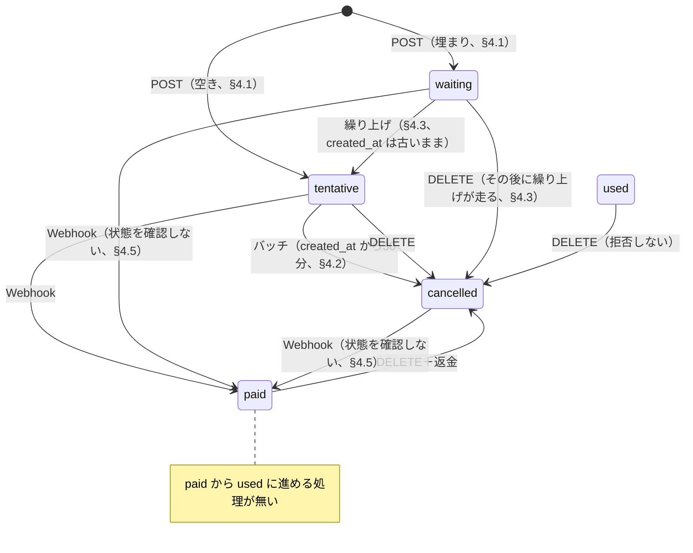
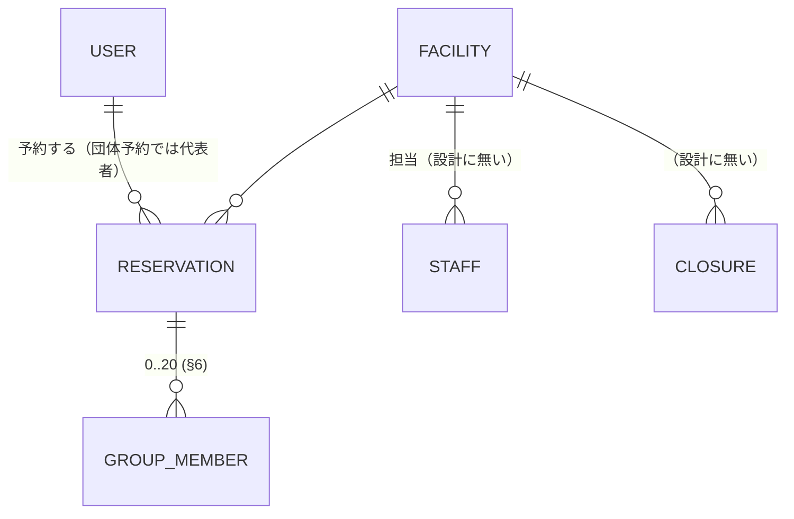

# 予約システム 仕様書 v0.9 / 設計書 v0.3 レビュー

両文書をモデルに書き起こし、仕様と設計を突き合わせました。設計にはそのまま実装すると壊れる箇所があります。同じ枠に予約が2件入る、お金だけ引き落とされて予約が消える、繰り上げた仮予約がすぐ失効する、の3つです。仕様の側では、決済処理中の状態、予約数の上限、繰り上げのきっかけが決まっていません。影響の大きい順に並べています。どの指摘も、作者が答えられる問いの形にしました。

---

## 指摘

### 1. リスク: 受付開始の時刻に同じ枠へ2件の予約が入る
- **箇所:** 設計 §2「1件だけとする（アプリで確認する）」、§4.1 の手順1と2、仕様 §11
- **モデル（並行性）:** A と B が同時に POST する。A の SELECT は空、B の SELECT も空、A が INSERT、B も INSERT。結果、同じ枠に `tentative` が2件になる。調べてから書き込むまでの間に、何も防ぐものがありません。
- **影響する場面:** 仕様 §11 が見込む、午前9時の受付開始時のアクセス集中で起きます。同じ枠に2人が支払い、2人とも当日施設に来ます。
- **問い:** 一意性は DB で保証しますか（`status IN (tentative, paid)` に対する部分一意インデックス、行ロック、SERIALIZABLE など）。§3.1 の1日2件の制限と、§4.3 の繰り上げにも同じ問題があります。

### 2. ギャップとリスク: 決済処理中の予約が失効・キャンセル・休館に当たったらどうなるか
- **箇所:** 仕様 §3.2（状態一覧に「決済処理中」が無い）、§5（「決済処理中」が出てくる）、設計 §2 の enum（無い）、§4.2、§4.5
- **モデル（状態表）:** 決済処理中の行が、30分経過、キャンセル、臨時休館、決済失敗のどの列も空です。設計にはこの状態そのものがありません。§4.5 は予約の現在の状態を見ずに `paid` にします。
- **壊れる流れ:** 29分目にカード情報を入力し、Webhook が31分目に届くとします。その前にバッチが予約を `cancelled` にし、別の人が同じ枠で `tentative` を取ります。そこへ Webhook が届いて元の予約が `paid` になると、同じ枠に有効な予約が2件になります。Webhook を拒否する作りにした場合でも、今度は「カードに請求されたのに予約が無い」状態になります。決済処理中に利用者がキャンセルした場合も同じことが起きます。
- **問い:** 決済処理中に30分の期限は止まりますか。決済処理中のキャンセルや休館は拒否しますか、それとも決済を取り消しますか。失効した予約に入金があったら自動で返金しますか。決済が失敗したら仮予約に戻しますか、そのまま失効させますか（失敗は仕様にも設計にも書かれていません）。

### 3. 矛盾: 繰り上げた仮予約が数分で失効する
- **箇所:** 仕様 §8「通知から30分以内」、設計 §4.2「`created_at` から30分」、§4.3（`waiting` を `tentative` に変える）
- **モデル（仕様と設計の照合）:** 繰り上げで状態を `tentative` にしても、`created_at` はキャンセル待ちに登録した時刻のままです。そのため次のバッチ（5分以内）で失効します。
- **影響する場面:** キャンセル待ちが実際には機能しません。利用者は「繰り上がりました」というメールを受け取ったのに、払う前に予約が消えます。
- **問い:** 期限の起点は列として別に持ちますか（`tentative_since` や `expires_at` など）。

### 4. リスク: キャンセル待ちを取り下げると、空いていない枠で繰り上げが起きる
- **箇所:** 設計 §4.3、§3 の API（DELETE で状態を確認していない）
- **モデル:** DELETE はどの状態の予約にも効き、そのたびに「最も古い `waiting` を `tentative` に」します。`waiting` の予約を取り下げても繰り上げが走るので、`paid` の予約が残っている枠に `tentative` がもう1件できます。`利用済み` や `cancelled` の予約に DELETE しても同じです。
- **問い:** 繰り上げは「有効な予約がキャンセルされて枠が空いたとき」だけに限りますか。仕様のほうでも、キャンセル待ちの取り下げを操作として定義しますか（§3.4 と §4 に書かれていません）。

### 5. ギャップ: 仮予約が失効して空いた枠は、キャンセル待ちに回るのか
- **箇所:** 仕様 §3.3「枠は空く」、§8「予約がキャンセルされて枠が空くと」
- **モデル:** 繰り上げのきっかけはキャンセルだけです。失効、つまり繰り上げた人が払わなかった場合を含めて、そのとき何が起きるかが書かれていません。設計 §4.2 も繰り上げをしません。
- **影響する場面:** 失効で空いた枠に、後から来た人が `POST` すると `tentative` が取れます。キャンセル待ちの列にいた人を追い越すことになります。
- **問い:** 失効でも繰り上げますか。繰り上げた人が払わなかったら次の人に回しますか。受付が締め切られた後や利用日の当日になったら、キャンセル待ちはどう終わりますか。

### 6. 矛盾: 1日の予約数の上限（§3.1）と団体予約（§6）
- **箇所:** 仕様 §3.1「同じ日に持てる予約は2件まで」、§6「同じ日に複数の団体予約…（最大5件）」
- **モデル（ドメインのルール）:** R2（1人1日2件）と R4（代表者は1日に団体予約5件まで）は、団体予約が予約に含まれるなら同時には成り立ちません。R2 で数える状態も決まっていません（仮予約やキャンセル待ちを含むのか）。設計はどちらの上限も確認しておらず、メンバー20人の上限（§6）も確認していません。そもそも `reservations` には団体予約かどうかを区別する列がありません。
- **問い:** 団体予約は §3.1 の例外ですか。個人予約2件と団体予約5件は別々に数えますか。何の状態を「持っている」として数えますか。繰り上げで上限を超える場合は飛ばしますか。

### 7. リスク: 誰でも決済完了の Webhook を送れてしまう
- **箇所:** 設計 §3 `POST /webhooks/payment`（呼べる人は「決済サービス」）、§4.5
- **モデル（データの流れと信頼境界）:** 外部と本システムの境界で、何が検証するかが書かれていません（署名の検証、金額や予約 ID の照合）。重複して届いた場合、順序が入れ替わった場合、届かなかった場合の扱いもありません。
- **影響する場面:** 偽の通知で、支払っていない予約を `paid` にできます。
- **問い:** 署名の検証、金額の照合、同じ通知を2回処理しないための仕組みを設計に入れますか。Webhook が届かないとき、決済サービスに状態を問い合わせて照合する手順はありますか。

### 8. ギャップとリスク: 臨時休館
- **箇所:** 仕様 §7、設計 §3 と §4.4
- **モデル:**
  - 休館そのものを保存する場所がありません。そのため休館日にも `POST /reservations` が通ります。
  - 「すべて取り消し」の範囲が書かれていません。キャンセル待ち、利用済み、決済処理中の予約が含まれるのか、また半日だけの休館や一部の時間枠だけの休館があるのかが分かりません。
  - 1回のリクエストの中で、件数分の返金 API とメール送信を順に呼びます。途中で失敗すると、一部だけ取り消された状態で終わります。もう一度実行すると返金が二重になります。
- **問い:** 休館は日付ごとですか、時間枠ごとですか。休館を保存して予約を拒みますか。返金とメールはジョブキューに移し、やり直せるようにしますか。

### 9. ギャップ: 仕様の権限が設計の API に反映されていない
- **箇所:** 仕様 §4、設計 §3
- **モデル（権限マトリクスと API の照合）:**
  - 施設スタッフの「当日の利用確認」（`used` にする操作）を行う API がありません。そのため `利用済み` には到達できません。
  - 利用者の「自分の予約の確認」に当たる GET がありません。
  - 管理者が使える API がありません。
  - 「担当施設」が設計に出てきません（スタッフと施設の対応関係が無い）。担当外の施設の一覧や休館に、どのスタッフでも手が届きます。
- **問い:** スタッフと施設の対応はどこに持ちますか。管理者の「すべての操作」には、代理でのキャンセル（期限後も含むか、返金するか）が入りますか。

### 10. ギャップ: キャンセルの期限と、キャンセルできる状態
- **箇所:** 仕様 §3.4「前日まで、いつでも」、§9、設計 §4.3
- **モデル:**
  - 「前日まで」がいつの時点までなのか書かれていません（前日の23:59か、窓口の閉まる時刻か）。
  - 設計は期限も状態も確認していません。当日や利用済みの予約でもキャンセルと全額返金ができてしまいます。
  - キャンセルの記録と返金 API の呼び出しを、どういう順序とトランザクションで行うかが書かれていません。返金に失敗したときに `cancelled` のまま返金されない、という状態が起こりえます。
- **問い:** 期限は何時何分までですか。返金に失敗したらどうしますか（リトライするか、スタッフに通知するか）。

### 11. ギャップ: 抜け出せない状態
- **モデル（状態表）:**
  - `支払い済み` の予約で、当日来なかった場合の扱いがありません。ずっと支払い済みのまま残ります。
  - `キャンセル待ち` は、利用日が過ぎても残り続けます。
- **問い:** 無断欠席はどの状態にしますか。キャンセル待ちはいつ打ち切りますか。

### 12. ギャップ: 受付の開始と終了
- **箇所:** 仕様 §9、設計（扱っていない）
- **モデル:**
  - 「1か月前」の数え方が決まっていません。たとえば3月31日の予約は2月の何日から受け付けるのか。
  - 当日の予約を受け付けるか、受付の締め切りがいつかが書かれていません。
  - 受付開始前にキャンセル待ちだけ登録できるのかも書かれていません。
  - 設計は受付開始時刻を確認していません。
- **問い:** 受付期間の両端を日時で定めてもらえますか。

### 13. リスク: 決済と個人情報の範囲
- **箇所:** 仕様 §5「カード情報は保持しない」、§10、設計 §3 `POST /reservations/{id}/payment`
- **モデル（データの流れ）:**
  - カード情報が API サーバーを通るのか、SPA から決済サービスに直接送られる（トークン化される）のかが書かれていません。API サーバーを通る場合、「保持しない」と書いてあっても PCI DSS の対象になります。
  - 次の3点も書かれていません。個人情報を何年保存するか。スタッフの一覧画面に電話番号や住所まで出すのか。アカウントの無いメンバーの氏名を登録することについて、本人の同意をどう扱うか。
- **問い:** カード情報の入力はリダイレクト方式かトークン方式ですか。スタッフにはどの項目を見せますか。

### 14. ギャップ: 決済処理中とキャンセル待ちに、支払いを始められてしまう
- **箇所:** 設計 §3 `POST /payment`（状態を確認していない）
- **影響する場面:** `waiting` の予約を支払うと、§4.5 によって `paid` になります。枠を押さえていない支払い済みの予約ができてしまいます。
- **問い:** 支払いを始められるのは `tentative` で、期限内のときだけに限りますか。

### 15. ギャップ: 非機能要件に数字が無い
- **箇所:** 仕様 §11「すぐに予約できること」
- **問い:** 次の数字を決めてもらえますか。受付開始時刻に何人が同時にアクセスするか。応答時間をどこまで許すか（たとえば p95 で何秒以内）。定期メンテナンスの時間帯と、その間に届いた Webhook の扱い（再送に頼るか）。

### 16. 用語: 「キャンセル」「取り消し」「失効」が設計ではすべて `cancelled` になる
- 理由（利用者のキャンセル、休館、未払いによる失効）と返金済みかどうかが記録に残りません。問い合わせに答えられず、指摘5と8の処理も分けられません。
- 「予約」は §2 では「枠を押さえること」と定義されています。一方で「キャンセル待ち」も予約の状態の1つとされていますが、枠は押さえていません。§3.1 で何を数えるかに直接関わります。
- **問い:** 終わった状態を種類ごとに分けますか（`expired`、`cancelled_by_user`、`cancelled_by_closure` など）。

---

## どのモデルを書いたか

書いたモデル（付録に載せています）:
- **状態遷移:** 仕様と設計の2つを書いて比べました。
- **権限マトリクス:** 書いて、設計の API と照合しました。
- **ドメインモデルとルール**
- **障害:** 外部の依存先ごとに書きました。
- **並行性と順序:** 主な割り込みのパターンを書きました。
- **データの流れと信頼境界**
- **キャパシティ**
- **用語**

書かなかったモデル:
- **画面遷移:** 仕様にも設計にも画面の記述がありません。指摘4、5、10は状態のレベルで拾っています。
- **運用（監視、監査）:** 文書にその範囲の記述がありません。返金失敗の検知（指摘10）だけを障害モデルの中で触れています。

並行性は TLA+ で検査したわけではなく、丁寧に読んだ結果です。ドメインルールも Alloy などのツールでは検査していません。

---

## 付録: モデル

### A1. 状態遷移（仕様）
`?` は書かれていないところ、*斜体* は書かれてはいないが読み取れるところです。

| 状態 ＼ イベント | 支払い開始 | 決済完了の通知 | 決済失敗 | 30分経過 | 利用確認 | 利用者のキャンセル | 臨時休館 | 繰り上げ | 利用日経過 |
|---|---|---|---|---|---|---|---|---|---|
| 仮予約 | 決済処理中 (§5) | *支払い済み* (§3.3) | ? | 失効、枠が空く (§3.3) | ? | キャンセル済み (§3.4) | 取り消し (§7) | – | ? |
| 決済処理中 | ? | 支払い済み (§5) | **?** | **?** | ? | **?** | 取り消し (§7)、返金は ? | – | ? |
| 支払い済み | ? | ?（重複） | – | – | 利用済み (§3.3) | キャンセル済み＋全額返金 (§3.4、前日まで) | 取り消し＋返金 (§7) | – | **?（無断欠席）** |
| 利用済み | – | – | – | – | – | *拒否*（前日を過ぎているため） | ?（§7「すべて」） | – | 終端? |
| キャンセル待ち | ? | ? | – | – | – | **?（取り下げ）** | ? | 仮予約 (§8、キャンセルが起きたときのみ) | **?** |
| 失効、キャンセル済み、取り消し | 名前は書かれておらず、終端だと読み取れる | | | | | | | | |

入口は「空き枠を予約すると仮予約」（§3.3）と「埋まっている枠ならキャンセル待ちに登録できる」（§3.3）の2つです。

### A2. 状態遷移（設計）と仕様との差

| 仕様にあるもの | 設計での扱い |
|---|---|
| 決済処理中 | 状態として無い |
| 失効、キャンセル、取り消しの区別 | すべて `cancelled` |
| 利用確認（used にする） | 処理も API も無い |
| 繰り上げは「通知から30分」 | `created_at` から30分 |
| キャンセルは前日まで | 確認していない |
| 受付は1か月前の9時から | 確認していない |

### A3. 権限マトリクス（仕様 §4 と設計 §3 の照合）

| ロール ＼ 操作 | 予約作成 | キャンセル | 自分の予約を見る | 支払い開始 | メンバー追加 | 施設の一覧を見る | 利用確認 | 臨時休館 |
|---|---|---|---|---|---|---|---|---|
| 利用者（本人の予約） | 可 / API あり | 可 / API あり | 可 / **API 無し** | *可* / API あり | – | 不可 | 不可 | 不可 |
| 代表者 | 可 | 可 | 可 | 可 (§6) | *可* / API あり（削除と編集は ?） | 不可 | 不可 | 可 (§7) |
| 担当施設のスタッフ | ? | ? | – | – | – | 可 / API あり | 可 / **API 無し** | 可 / API あり |
| 担当外の施設のスタッフ | ? | ? | – | – | – | *不可* / **設計では可能** | *不可* | *不可* / **設計では可能** |
| 管理者 | 「すべて」 / **API 無し** | 〃 | 〃 | ? | ? | 〃 | 〃 | 〃 |
| メンバー（アカウント無し） | – | – | **?（見る手段が無い）** | – | – | – | – | – |
| 決済サービス | Webhook / **認証が書かれていない** | | | | | | | |

### A4. ドメインモデルとルール

| # | ルール | 根拠 | 設計で守られているか |
|---|---|---|---|
| R1 | 1つの枠に有効な予約は1件まで | 設計 §2（仕様からも読み取れる） | アプリで確認するだけで競合する（指摘1）。Webhook でも破れる（指摘2）。どの状態を「有効」とするかに決済処理中と利用済みが入っていない |
| R2 | 1人あたり1日2件まで | 仕様 §3.1 | 確認していない。数える状態が決まっていない（指摘6） |
| R3 | 団体予約のメンバーは20人まで | 仕様 §6 | 確認していない |
| R4 | 代表者が1日に持てる団体予約は5件まで | 仕様 §6 | 確認していない。R2 と衝突する |
| R5 | キャンセルは前日まで | 仕様 §3.4 | 確認していない |
| R6 | 受付は1か月前の9時から | 仕様 §9 | 確認していない |
| R7 | 仮予約の期限は30分（繰り上げの場合は通知から） | 仕様 §3.3、§8 | 起点が違う（指摘3） |
| R8 | キャンセル待ちは先着順 | 仕様 §8「先頭」 | `created_at` 順なので守られている。ただし失効で空いた枠では追い越しが起きる（指摘5） |
| R9 | 休館日には予約できない | *仕様 §7 から読み取れる* | 休館を保存していない |

時間枠は `slot` 0〜5 の2時間単位、つまり12時間分です。何時から何時までなのかは書かれていません。予約料金の決め方も仕様に書かれていません。

### A5. 障害

| 依存先と処理 | 失敗、タイムアウト | 2回成功する | 届かない、遅れる |
|---|---|---|---|
| 決済（支払い開始） | ? | ? | – |
| 決済の Webhook | 決済失敗の通知が定義されていない | 冪等かどうか書かれていない | 30分を過ぎると失効と競合する（指摘2）。照合の手順が無い |
| 返金 API（キャンセル） | ?（`cancelled` だけ残る） | ? | ? |
| 返金 API（休館） | 一部だけ取り消された状態で止まる。やり直すと二重返金（指摘8） | ? | ? |
| メール（繰り上げ） | 30分の期限は進み続ける。再送するか ? | – | ? |
| メール（休館） | ? | – | ? |
| 失効バッチ | 止まると仮予約が枠を押さえ続ける。監視は ? | 2つ同時に動いた場合 ? | 30〜35分の幅がある |

### A6. 並行性（読んで確認した範囲）

| 割り込みのパターン | 結果 |
|---|---|
| 同じ枠に POST が2つ（§4.1） | `tentative` が2件（指摘1） |
| 失効バッチと Webhook | 失効した予約が `paid` になる。同じ枠に2件、または請求だけ残る（指摘2） |
| DELETE と Webhook | キャンセル済みの予約が `paid` になる |
| 同じ枠に DELETE が2つ（片方は waiting の取り下げ） | 繰り上げが2回走り、`tentative` が2件（指摘4） |
| 失効と新しい POST | キャンセル待ちが追い越される（指摘5） |
| 同じ利用者の POST が3つ同時（同じ日） | R2 を確認していないので3件とも通る |

### A7. データの流れと信頼境界

| 越える境界 | データ | 何が守るか |
|---|---|---|
| ブラウザ → API | 氏名、電話番号、住所、メールアドレス、メンバーの氏名 | 入力の検証は ? |
| ブラウザ → 決済サービス、または API を経由 | カード情報 | **経路が書かれていない**（指摘13） |
| 決済サービス → API（Webhook） | 決済の結果 | **書かれていない**（指摘7） |
| API → メール配信サービス | メールアドレス、氏名、予約内容 | ? |
| API → スタッフの画面 | 予約者の個人情報 | 表示する項目と、担当施設に限るかどうかは ?（指摘9、13） |
| 保存 | 個人情報 | 保存期間と削除の方法は ? |

### A8. キャパシティ

| 想定される負荷 | 書かれている目標 | 結論 |
|---|---|---|
| 毎日午前9時に、1か月後の全施設の受付が一斉に始まる（§9）。同時アクセスの人数は書かれていない | 「すぐに予約できる」（数字なし、§11） | 目標を検証できない。その時刻には指摘1の競合が最も起きやすい |
| 臨時休館での一括処理（件数分の外部 API 呼び出しを同期で行う） | 書かれていない | リクエストがタイムアウトする恐れがある |

### A9. 用語

| 用語 | 意味と使われている箇所 | 問題 |
|---|---|---|
| 予約 | 枠を押さえること（§2）。キャンセル待ちも予約の状態とされる（§3.2）。設計ではキャンセル待ちも `reservations` の1行 | 押さえていないものまで「予約」と呼んでいる。§3.1 で数える対象に関わる |
| キャンセル、取り消し、失効 | §3.4、§7、§3.3 | 設計ではすべて `cancelled` |
| 利用者、代表者 | §2、§6 | 代表者は利用者の一種。上限の数え方が決まっていない |
| 決済処理中 | §5 にだけ出てくる | §3.2 の状態一覧にも設計にも無い |
| 前日まで、当日 | §3.4、§3.3 | 時刻での区切りが書かれていない |

---

ここに書いたモデルを、確認項目のチェックリストに変換することもできます。文書で答えが決まっている箇所はチェック項目にし、未決の箇所は「回答待ち」として、どの指摘への回答待ちかを添えて分けます。作りましょうか。
